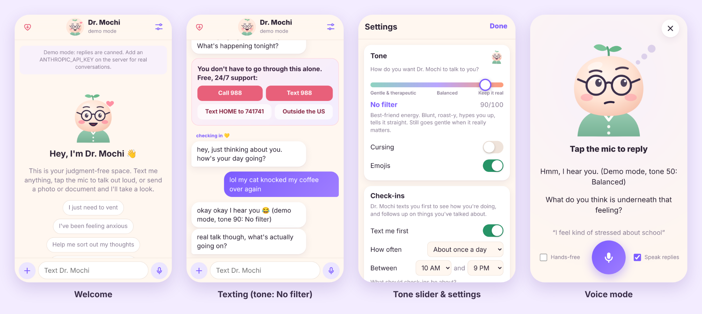

# Dr. Mochi: a cartoon AI therapist you can text

A private texting app where you talk to **Dr. Mochi**, a cartoon AI therapist. You type or talk out loud, and it texts back. You can send it photos and documents to look at, it texts *you* first to check in, and a slider controls how gentle or how real it is with you. It installs on your iPhone like a normal app.

**It can run completely free**, either on Cloudflare's free plan or on your own computer with Ollama, using Google's open Gemma 4 model. Or use Claude for the best conversations (you pay per message). Same app, same features. See [Three ways to run it](#three-ways-to-run-it).



## What it does

- **Texting.** Replies stream in like someone typing and come as separate texts. The cartoon's face reacts to what it's saying: warm, laughing, thinking, concerned, proud, or curious.
- **Talking.** Tap the mic (or the face at the top) to talk out loud. Your words go in as texts and Dr. Mochi texts back. It can also read its replies out loud, and **hands-free** mode keeps listening after each reply so it feels like a conversation.
- **Photos and documents.** Send photos (screenshots of a group chat, a picture of your room, anything) and PDFs, Word (.docx) or text files (journals, letters, worksheets, even whole books). It actually reads them and responds to what's in them. Short documents are read in full. For long ones it reads the opening plus the parts that match what you ask about, and it can find those parts again later in the chat ("remember what my journal said about the ferry?").
- **It texts you first.** Check-ins arrive as phone notifications. In Settings you choose:
  - on or off
  - how often (every few days → every few hours)
  - which hours it's allowed to text you
  - what check-ins are about: how you're feeling, follow-ups on things you talked about, encouragement, self-care reminders

  If you ignore a few check-ins it backs off, and it pauses entirely until you reply. It can also notify you when a reply finishes after you've closed the app.
- **Tone slider.** From **0 (gentle & therapeutic)** through **50 (balanced)** to **100 (keep it real)**, with jokes, banter and blunt honesty at the top end. There are also switches for cursing and emojis.
- **Memory.** It keeps short private notes about you (people in your life, what you're working on, things to follow up on) so it remembers between chats. You can read, edit, or erase them in Settings.
- **Safety first.** At any tone setting, if you mention self-harm, suicide, or being in danger, it drops the jokes, checks on your safety, and shows a card with one-tap links to 988 and the Crisis Text Line. The ♡ button at the top always opens those resources.

> Dr. Mochi is an AI, not a licensed therapist. It can be wrong, and it isn't for emergencies. If you might hurt yourself or someone else, call or text **988** in the US, text **HOME** to **741741**, or call your local emergency number.

---

## Three ways to run it

| | **Free: Cloudflare** | **Free: your own computer** | **Claude** |
| --- | --- | --- | --- |
| Cost | **$0**, no credit card | **$0** | Pay per message to Anthropic (about a cent or a few cents each), plus hosting if you use Render/Railway |
| AI | Gemma 4 (Google's open model) on Cloudflare Workers AI | Gemma 4 (or any Ollama model) running on your computer | Claude, the most natural and thoughtful conversations |
| Limits | Roughly 250 texts a day; resets at midnight UTC | None, but your computer has to be on and awake | None |
| Privacy | Chats stored in your Cloudflare account; Cloudflare says it doesn't train on them | Nothing leaves your computer except through the tunnel you choose | Chats on your server; messages sent to Anthropic |
| Setup | About 10 minutes in a browser (works from a phone) | About 20 minutes; needs a reasonably recent computer (8 GB+ memory) | About 15 minutes |

All three have the same app: the cartoon, voice, photos, documents, tone slider, check-in notifications, memory, and the iPhone profile. You can start free and switch to Claude later by adding one setting, without losing your chats.

---

## Free version: set it up on Cloudflare (about 10 minutes)

All of this happens in a web browser; you don't need a computer or any code.

### 1. Make a free Cloudflare account

Go to [dash.cloudflare.com/sign-up](https://dash.cloudflare.com/sign-up), sign up with your email, and click the link in the verification email. The Workers Free plan is the default, and no card is needed.

### 2. Connect this app to Cloudflare

1. In the Cloudflare dashboard, open **Workers & Pages** → **Create application** → **Import a repository** (Get started).
2. Connect your GitHub account when asked. You can limit access to just the **mc-mod** repository.
3. Pick **mc-mod**. Set the **project/Worker name to `dr-mochi`** (it must match). Leave the root directory and build command empty, and keep the deploy command `npx wrangler deploy`.
4. Tap **Save and Deploy**. Cloudflare builds the app and creates its database automatically. When it's done you'll see an address like `https://dr-mochi.YOUR-NAME.workers.dev`.
5. Open the Worker's **Settings → Build → Branch control** and make sure the production branch is **`claude/therapy-texting-app-sfftxo`** (the branch with the app). Turn off preview builds.

From then on, every update to that branch deploys by itself.

### 3. Add your access code

The access code is the password for your chats. You set it in Cloudflare, so nobody else can claim the app before you do:

1. In the Worker, open **Settings → Variables and Secrets → Add**.
2. Pick the type **Secret**, name it `ACCESS_CODE`, and type a code you'll remember (8 or more characters; longer is safer).
3. Click **Deploy**.

Until the code exists, the app only shows these steps. Forgot it? Set a new one the same way; that also logs every device out.

### 4. Put it on your iPhone and turn on notifications

Same as the Claude version: see [Put it on your iPhone](#4-put-it-on-your-iphone) and [Turn on notifications](#5-turn-on-notifications) below, using your `workers.dev` address.

### Good to know about the free version

- **Daily allowance.** Cloudflare gives every account 10,000 free AI "neurons" a day. That's roughly 250 typical texts with Gemma 4 (fewer if you send lots of photos or long documents). **Settings → Free AI** shows how much is left. If it runs out, Dr. Mochi says it's resting until the reset (midnight UTC), and check-ins still go out as simple messages.
- **The AI is different.** Gemma 4 is a capable open model, but Claude is noticeably better at nuanced, emotionally intelligent conversation. The same safety rules apply, and the app also watches for crisis words itself, so the help card appears even if the model misses them.
- **Photos** are looked at when you send them (Dr. Mochi remembers what it saw afterwards, not the photo itself). The app shrinks photos automatically.
- **Photos per message.** Dr. Mochi looks at up to 4 photos at a time; if you send more, it asks for the rest separately.
- **Documents.** Files up to 20 MB with up to about 500 pages of text. PDFs and Word files are turned into text for free when you upload them. Short documents are read in full. For long ones, Dr. Mochi sees the opening plus the parts that best match what you say. Ask about a chapter, a name or a phrase, and it finds it. Scanned PDFs (pictures of pages) have no text, so send those as photos. The free database can take a couple dozen long documents a day; files you attach but never send are cleared out after a day.
- **Talking.** Uses your phone's speech recognition when it's available; otherwise the app records you and Cloudflare's free Whisper model writes down what you said.
- **Privacy.** Your chats are stored in your own Cloudflare D1 database. Cloudflare says Workers AI doesn't use your messages to train models.
- **Switch to Claude anytime.** Add a Secret named `ANTHROPIC_API_KEY` (see step 1 below) in **Settings → Variables and Secrets**. Hosting stays free; you only pay Anthropic per message.

**If the first build fails** with a permissions error about D1: go to **My Profile → API Tokens → Create Token**, give it *Workers Scripts: Edit*, *D1: Edit* and *Account Settings: Read*, then pick that token under the Worker's **Settings → Build → API token** and retry the build. If it says you need a `workers.dev` subdomain, open **Workers & Pages**, choose one, and retry.

---

## Free version on your own computer (Ollama)

Everything runs on your Mac or PC, including the AI, so it's free and private. The catch: your computer has to be on and awake for Dr. Mochi to reply or check in.

1. **Install Ollama** from [ollama.com](https://ollama.com) and open it. Then, in Terminal (Mac) or PowerShell (Windows), download the model (a few GB):
   ```bash
   ollama pull gemma4
   ```
   On an older or 8 GB computer, use the smaller one instead: `ollama pull gemma4:e2b`, and add `OLLAMA_MODEL=gemma4:e2b` to your `.env` in step 3.
2. **Install Node.js** (version 20 or newer) from [nodejs.org](https://nodejs.org). Download this project (on GitHub: **Code → Download ZIP**) and unzip it.
3. **Start Dr. Mochi.** In Terminal, go into the project folder, then:
   ```bash
   npm install
   cp .env.example .env     # then open .env and set ACCESS_CODE to your own private code
   npm start
   ```
   With no Claude key in `.env`, it uses Ollama automatically. The startup message says whether Ollama and the model are ready. Open [http://localhost:3000](http://localhost:3000) on the computer.
4. **On your iPhone.** On the same Wi-Fi, Safari can open `http://<your computer's local IP>:3000` for plain chatting. For the full iPhone app (Home Screen icon, notifications, microphone), iPhone requires an **https** address, which a free tunnel provides:
   - [Tailscale Funnel](https://tailscale.com/kb/1223/funnel) gives a permanent address like `https://your-computer.your-tailnet.ts.net`: install Tailscale, then run `tailscale funnel 3000`.
   - Or, for a quick try: `npx cloudflared tunnel --url http://localhost:3000` prints a `https://….trycloudflare.com` address. It changes every time you start it, so you'd have to reinstall the iPhone app each time.

   Put that address in `.env` as `PUBLIC_URL=https://…`, restart with `npm start`, then follow [Put it on your iPhone](#4-put-it-on-your-iphone) using that address.
5. **Keep the computer awake** while you want check-ins: on a Mac, run `caffeinate -s` in another Terminal window; on Windows, set sleep to "Never" while plugged in.

Photos and documents work the same way, with files up to 50 MB (thousands of pages). PDFs are turned into text on your computer, and long documents are searched the same way so they fit the local model. Scanned PDFs (pictures of pages) have no text, so send those as photos. Talking out loud uses your phone's own speech recognition (or the keyboard's dictation mic).

---

## Claude version: set it up (about 15 minutes)

You need two things: a **Claude API key** (this is what makes Dr. Mochi think) and somewhere to **host the app** so your phone can reach it, even when your computer is off. (You can also use the free Cloudflare hosting above and just add your key there.)

### 1. Get a Claude API key

1. Go to [console.anthropic.com](https://console.anthropic.com), sign up, and add a payment method under **Billing**.
2. Open **API Keys** → **Create Key**, and copy it. It starts with `sk-ant-`.

You pay per message. With the default model, a normal text exchange costs roughly a cent or a few cents; photos and documents cost more. Documents up to about 300 pages of text are read in full; for longer ones Claude gets the opening and the parts that match what you ask, which keeps a book from costing dollars per reply. Small PDFs (up to 100 pages and 10 MB) are read with their pictures and layout. To spend less, set `CLAUDE_MODEL` to `claude-sonnet-5-5` (cheaper) or `claude-haiku-5-5` (much cheaper).

### 2. Pick an access code

Make up a private code, like a password. Anyone with your app's address *and* this code could read your chats, so make it long and don't reuse one from somewhere else.

### 3. Host the app

The app has to stay running all the time, so check-ins can go out, and it needs a disk that survives restarts, so your chats and memory are kept. Free tiers that sleep or wipe their disk won't work well.

**Option A: Render (easiest)**

1. Create an account at [render.com](https://render.com) and connect your GitHub.
2. Click **New → Blueprint** and pick this repository. Render reads `render.yaml` and sets up a web service with a 1 GB disk on the Starter plan.
3. When it asks, paste your `ANTHROPIC_API_KEY` and your `ACCESS_CODE`.
4. After it deploys, you'll get an address like `https://dr-mochi-xxxx.onrender.com`.

**Option B: Railway**

1. Create a project at [railway.app](https://railway.app) → **Deploy from GitHub repo** → pick this repo. It builds the included `Dockerfile`.
2. Add a **Volume** mounted at `/data`.
3. Under **Variables**, add `ANTHROPIC_API_KEY` and `ACCESS_CODE`.
4. Under **Settings → Networking**, click **Generate Domain** to get your https address.

**Option C: Any server with Docker**

```bash
docker build -t dr-mochi .
docker run -d --restart unless-stopped -p 3000:3000 -v mochi-data:/data \
  -e ANTHROPIC_API_KEY=sk-ant-... -e ACCESS_CODE=your-code -e PUBLIC_URL=https://your.domain \
  dr-mochi
```

Put it behind https (for example with Caddy or a Cloudflare Tunnel). The mic, notifications, and installing on iPhone all require https.

### 4. Put it on your iPhone

On your iPhone, open **`https://YOUR-ADDRESS/install` in Safari**. On a computer, that page shows a QR code you can scan with your phone. Then follow the steps on the page:

**Install profile (the iOS configuration profile)**

1. Tap **Download install profile**, then **Allow**.
2. Open the **Settings** app → tap **Profile Downloaded** near the top → **Install**, enter your passcode, then **Install** again.
   It says "Not Verified" because it's your own unsigned profile; that's expected. The profile only adds a full-screen Home Screen icon. It doesn't manage or monitor anything on your phone, and you can remove it anytime in **Settings → General → VPN & Device Management**.
3. Open **Dr. Mochi** from your Home Screen and type your access code.

**Or: Add to Home Screen**

In Safari, tap **Share → Add to Home Screen**. This is the way Apple officially supports for web-app notifications, so if the profile version never offers to turn notifications on, add it this way too and use that one. (Whether profile-installed apps get notifications isn't documented by Apple; it needs testing on your phone.)

The profile is generated by the server at `/app.mobileconfig`, already pointed at your address. If you want the file itself, for example to AirDrop it, run `npm run profile -- https://YOUR-ADDRESS`.

### 5. Turn on notifications

In the app, tap the **sliders icon** (top right) → **Check-ins** → **Notifications: Turn on** → **Allow**. Then tap **Test notification**. iPhone notifications for web apps need **iOS 16.4 or newer** and only work in the Home Screen app, not in a Safari tab. If you installed with the profile and the app never asks for permission, delete that icon and use **Add to Home Screen** instead.

---

## Settings at a glance

| Setting | What it does |
| --- | --- |
| **Tone** slider | 0 = gentle & therapeutic, 50 = balanced, 100 = keep it real (jokes, blunt honesty). The face previews the vibe as you slide. |
| Cursing / Emojis | Whether it swears and uses emojis. |
| **Text me first** | Turns check-ins on or off. |
| How often / Between | Check-in frequency and the hours it's allowed to text you (in your phone's time zone). |
| Check-in topics | Mood check-ins, follow-ups on what you talked about, encouragement, self-care reminders. |
| Notify when a reply finishes | If you leave the app mid-reply, you get the reply as a notification. |
| Send me a check-in now | See what a check-in looks like right away. |
| Voice | Read replies out loud, pick the voice and speed, send when you stop talking, hands-free. Saved per device. |
| Personalize | Rename the therapist; tell it what to call you. |
| Memory | View, edit, refresh, or erase what it remembers about you. |
| Your data | Download your chats as JSON, delete chat history, lock the app. |

## Privacy

- Your chats, memory notes and uploaded files are stored only on **your** server: `DATA_DIR` for the Node version, your own D1 database for the Cloudflare version.
- Where messages go to generate replies:
  - **Claude:** your messages, photos and files go to Anthropic's API. See Anthropic's [privacy policy](https://www.anthropic.com/legal/privacy).
  - **Free Cloudflare version:** they go to Workers AI in your Cloudflare account. Cloudflare says it doesn't use them to train models.
  - **Free local version:** the AI runs on your computer, so they stay there (plus the tunnel you choose for iPhone access).
- The app is locked behind your access code with an HttpOnly cookie. Wrong guesses are limited (10 per 15 minutes per address). Changing `ACCESS_CODE` logs every device out and stops notifications to them until you unlock them again.
- **Lock app** (in Settings) logs this device out, turns off its notifications, and clears cached photos and files.
- Notifications only go to real browser push services (Apple, Google, Mozilla, Microsoft).
- **Delete chat history** removes all messages and uploaded files from the server. **Erase** (under Memory) wipes the notes.

## Configuration

| Variable | Required | Default | Notes |
| --- | --- | --- | --- |
| `ANTHROPIC_API_KEY` | for Claude | | Your Claude API key. Without it, the Node server uses Ollama on the same computer (free). |
| `ACCESS_CODE` | yes | | The code you type to unlock the app. |
| `DATA_DIR` | | `./data` | Where chats, memory, uploads and push keys live. Use a persistent disk. |
| `PUBLIC_URL` | | auto | Your https address. Detected automatically on Render and Railway. Used in the iPhone profile and QR code. |
| `CLAUDE_MODEL` | | `claude-opus-5-5` | Try `claude-sonnet-5-5` or `claude-haiku-5-5` to lower cost. |
| `CHAT_EFFORT` | | `medium` | `low` replies faster; `high` thinks harder; `none` turns the setting off. |
| `VAPID_PUBLIC_KEY` / `VAPID_PRIVATE_KEY` | | generated | Push notification keys, generated once and saved in `DATA_DIR`. If you change them later, the app re-registers each device the next time it's opened. |
| `VAPID_SUBJECT` | | your URL | Contact address push services can use (`mailto:` or https). |
| `MOCK_AI` | | | Set to `1` for canned replies with no API key (demo/testing). |
| `OLLAMA_MODEL` | | `gemma4` | Free local mode (used when there's no Claude key): which Ollama model to use. |
| `OLLAMA_URL` | | `http://127.0.0.1:11434` | Where Ollama is running. |
| `OLLAMA_NUM_CTX` | | `16384` | The model's context window in tokens. Lower it on computers with little memory. |
| `OLLAMA_VISION` | | on | Set to `0` if your model can't see images. |

Cloudflare (free) version: the same names work as **Secrets** or **Variables** on the Worker (`ACCESS_CODE`, which is required there, plus `ANTHROPIC_API_KEY`, `CLAUDE_MODEL`, `CHAT_EFFORT`, `PUBLIC_URL`, `VAPID_*`, `MOCK_AI`), plus:

| Variable | Default | Notes |
| --- | --- | --- |
| `AI_MODEL` | `@cf/google/gemma-4-26b-a4b-it` | The free Workers AI model. `@cf/meta/llama-4-scout-17b-16e-instruct` also sees photos. |

Storage is the `DB` D1 database in `wrangler.jsonc`, created on first deploy. Check-ins run from a Cron Trigger every 5 minutes. Documents are searched with D1's full-text index; because of it, `wrangler d1 export` needs `--table <name>` (Cloudflare can't export a whole database that has a full-text index).

## Run it on your computer

Requires Node.js 20.12 or newer.

```bash
npm install
npm run demo          # canned replies, access code "demo" → http://localhost:3000
cp .env.example .env  # then set ACCESS_CODE (and ANTHROPIC_API_KEY to use Claude instead of Ollama)
npm start             # the real thing
npm test              # unit tests
npm run cf:demo       # the Cloudflare version locally (canned replies, code "demo"; no account needed) → http://localhost:8787
```

To try it on your phone before deploying, expose your computer over https, e.g. `cloudflared tunnel --url http://localhost:3000`, and open the printed address in Safari.

## How it works

- `worker/`: the free Cloudflare version. The same `/api` as the Node server, so the same frontend works on both. `store.js` uses D1; `ai.js` runs Workers AI (or Claude if a key is set); `webpush.js` sends notifications with WebCrypto; the `scheduled` handler runs check-ins.
- `server/`: the Node/Express version. `ai.js` talks to Claude with streaming, prompt caching and a server-side safety fallback; `scheduler.js` runs check-ins; `push.js` sends Web Push notifications; `store.js` keeps everything in one JSON file. Shared by both versions: `prompts.js` (persona, tone bands, check-in instructions), `history.js` (turning chats into model input), `checkins.js` (when to check in), `safety.js` (crisis-word backstop), `file-types.js`, `settings.js`, `time.js` and `profile.js` (the iPhone `.mobileconfig`).
- `public/`: the installable web app (no build step). `js/avatar.js` is the cartoon (one SVG, with expressions driven by CSS), `js/voice.js` handles speech recognition and read-aloud, and `sw.js` is the service worker for notifications and offline loading.
- Each reply starts with a hidden `[[mood:…]]` tag that sets the cartoon's face, and uses `|||` to split into separate texts. A `[[crisis]]` tag shows the help card.
- `npm run icons` regenerates the app icons from the cartoon (needs Playwright + Chromium).
